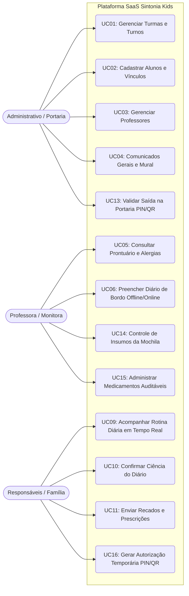
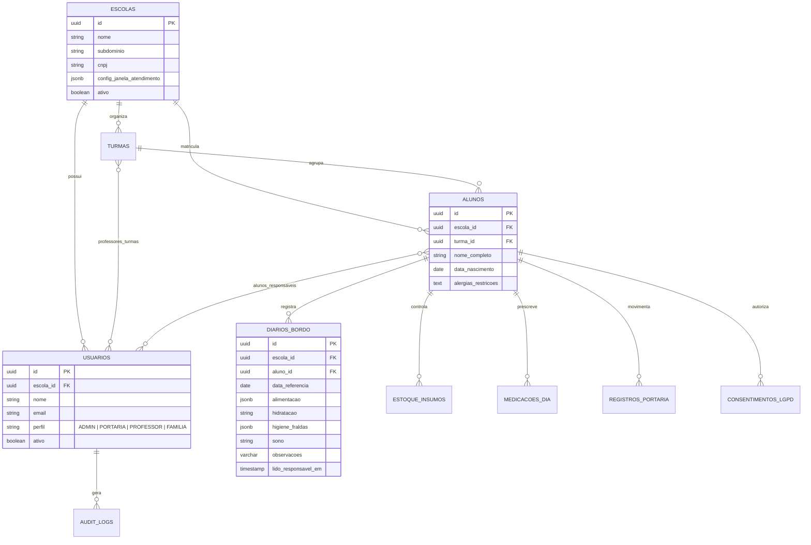

# Sintonia Kids — Plataforma SaaS de Agenda Digital Escolar Infantil

[-red.svg)](#-licença-e-direitos-autorais)

---

### 👨‍💻 Contexto Profissional & Apresentação de Portfólio
> **Autor & Arquiteto:** **Anderson de Oliveira** — Engenharia de Software & Arquitetura de Soluções  
> **Tipo de Projeto:** Estudo de Caso de Arquitetura de Software, Engenharia de Produto e UI/UX Mobile-First  
> **Finalidade do Repositório:** Demonstração técnica de competências avançadas em arquitetura de microsserviços/SaaS B2B, modelagem de dados relacional com isolamento de tenant em nível de banco (*Row-Level Security*), sistemas resilientes *Offline-First* e conformidade com privacidade infantil (**LGPD Art. 14**).

---

## 🌟 Visão Geral do Produto

O **Sintonia Kids** é uma plataforma SaaS B2B Multi-tenant desenvolvida para digitalizar a rotina operacional e pedagógica de **Berçários, Maternais e Pré-Escolas**. Substitui as obsoletas agendas físicas de papel por uma aplicação híbrida de alta performance, proporcionando agilidade instantânea para educadores em sala de aula e tranquilidade auditável para as famílias.

🔗 **Showcase Interativo do MVP:** [showcase.html](showcase.html)  
🔗 **Aplicação Web / PWA:** [index.html](index.html)

---

## 🚀 Diferenciais de Engenharia

* **Ergonomia *One-Thumb UX*:** Interface Mobile-First concebida para operação com uma única mão. Botões táteis com área mínima de 48px e fluxos otimizados permitem o preenchimento da rotina diária de uma turma inteira em menos de **15 segundos**.
* **Resiliência *Offline-First* (Service Worker + IndexedDB):** Funcionamento ininterrupto mesmo em ambientes com quedas frequentes ou oscilações de Wi-Fi escolar. Os registros de alimentação, sono e saúde são gravados localmente no dispositivo e sincronizados de forma transparente assim que a conectividade for restabelecida.
* **Isolamento de Tenants via PostgreSQL RLS (Row-Level Security):** Segurança nativa a nível de motor de banco de dados. O isolamento entre instituições de ensino (`escola_id`) é fiscalizado pelo próprio PostgreSQL através de políticas de RLS e funções de sessão (`SET LOCAL app.current_escola_id`), eliminando vetores de vazamento de dados (*data leak*) mesmo na camada de aplicação.
* **Conformidade Estrita com LGPD (Art. 14):** Arquitetura desenhada desde a concepção (*Privacy by Design*) para proteção de dados pessoais de crianças e adolescentes. Fluxo de consentimento digital auditável, registros imutáveis e criptografia de ponta a ponta (`pgcrypto`) para contatos de emergência e prontuários médicos.
* **Gestão Auditável de Medicamentos:** Cadastro da prescrição pelos pais acompanhado de foto de receita, cronômetro regressivo inteligente para a dose e confirmação de administração com dupla checagem pela professora.
* **Portaria Segura (Check-out com PIN Temporário / QR Code):** Sistema dinâmico de liberação de alunos com validação de terceiros autorizados, reduzindo filas no portão e notificando instantaneamente os pais via Web Push.

---

## 📱 As 5 Telas Essenciais do MVP

O estudo de caso contempla a jornada ponta a ponta da rotina escolar infantil. As capturas em alta resolução (**2x Retina DPI**) estão documentadas no diretório [`docs/prints_apresentacao/`](docs/prints_apresentacao/):

| Tela | Especificação do Módulo | Captura Mobile (390x844) |
| :--- | :--- | :---: |
| **01. Login & LGPD** | Acesso multi-perfil (*Família*, *Educador*, *Gestão*) com modal de Aceite Digital nos termos do Art. 14 da LGPD. | [Ver Print](docs/prints_apresentacao/mobile_01_login.png) |
| **02. Diário da Professora** | Painel do educador com seletor de turma, indicador de sincronização offline e **lançamento em lote**. Alerta visual inteligente de insumos (*ex: ⚠️ Restam 4 fraldas*). | [Ver Print](docs/prints_apresentacao/mobile_02_professora_diario.png) |
| **03. Visão dos Pais** | Linha do tempo visual do aluno (*Lucas Silva*), resumo de refeição, hidratação, sono, bilhete carinhoso da professora e botão **"Confirmar Leitura (Ciente)"**. | [Ver Print](docs/prints_apresentacao/mobile_03_pais_agenda.png) |
| **04. Informes & Medicamentos** | Mural de comunicados oficiais com taxa de leitura percentual e controle de dosagem pediátrica (*Paracetamol 15 gotas auditado*). | [Ver Print](docs/prints_apresentacao/mobile_04_informes_medicacao.png) |
| **05. Portaria Segura** | Terminal da portaria para liberação de saída escolar com **PIN dinâmico (`#8492`)**, QR Code e lista de parentes autorizados. | [Ver Print](docs/prints_apresentacao/mobile_05_portaria.png) |

> Para visualização em tela cheia do painel administrativo e terminal de portaria, consulte [desktop_01_painel_geral.png](docs/prints_apresentacao/desktop_01_painel_geral.png) e [desktop_02_portaria.png](docs/prints_apresentacao/desktop_02_portaria.png).

---

## 🏛️ Arquitetura e Modelagem

### Casos de Uso e Atores do Sistema

### Modelagem Conceitual de Dados (Entity-Relationship)

---

## 💻 Stack Tecnológica

| Camada | Tecnologia Adotada / Referenciada | Justificativa Arquitetural |
| :--- | :--- | :--- |
| **Frontend / PWA** | Vanilla ES6+ / Tailwind CSS / Lucide / IndexedDB API | Zero dependências pesadas no client, performance instantânea em dispositivos móveis modestos e instalação PWA nativa. |
| **Backend & Autenticação** | PostgreSQL 15+ com Supabase / Row-Level Security (RLS) | Autenticação granular via JWT, governança multi-tenant em nível de banco e APIs REST auto-geradas. |
| **Persistência & Criptografia** | `pgcrypto` + Extensões UUID v4 | Criptografia em repouso para dados médicos e identificadores não-sequenciais imunes a enumeração. |
| **Armazenamento de Mídia** | S3-Compatible Storage (URLs assinadas) | Prescrições médicas e fotos de alunos acessíveis exclusivamente via tokens de curta duração (15 min). |
| **Notificações** | Web Push API / Service Workers | Alertas de emergência, saída de portaria e reposição de insumos em tempo real. |

---

## 🔒 Segurança e Conformidade LGPD

Por se tratar de um ambiente que manipula dados de crianças (Art. 14 da LGPD) e dados sensíveis de saúde:
1. **Governança Multi-Tenant:** Políticas estritas de **Row-Level Security (RLS)** garantem que consultas de uma instituição jamais acessem registros de outra, mesmo em caso de falha na camada de aplicação.
2. **Consentimento Explícito:** Trilha de auditoria digital com timestamp e versão dos termos de consentimento aceitos pelos responsáveis legais.
3. **Imutabilidade e Trilha de Auditoria:** Eventos críticos (administração de medicação, retirada na portaria e alterações de responsáveis autorizados) geram logs imutáveis na tabela `AUDIT_LOGS`.

---

## 📚 Documentação Técnica Adicional

* [docs/especificacao_projeto_v1.2.md](docs/especificacao_projeto_v1.2.md) — Especificação detalhada de requisitos, arquitetura de dados e matriz de rastreabilidade.
* [docs/prints_apresentacao/](docs/prints_apresentacao/) — Catálogo de capturas de tela do MVP em alta definição (2x DPI).
* [supabase/migrations/](supabase/migrations/) — Scripts DDL e DML demonstrando a implementação prática de schemas PostgreSQL, RLS e triggers.

---

## ⚖️ Licença e Direitos Autorais

Este projeto e toda a sua documentação associada são regidos por uma **Licença Proprietária (All Rights Reserved)**.

Copyright (c) 2026 **Anderson de Oliveira**. Todos os direitos reservados.

> O código-fonte, diagramas e arquitetura disponibilizados neste repositório têm caráter **estritamente expositivo e demonstrativo para análise de portfólio profissional e avaliação técnica de engenharia de software**.  
> É estritamente proibida a cópia, reprodução, redistribuição, hospedagem ou exploração comercial/institucional, total ou parcial, sem autorização formal expressa por escrito do autor.  
> Para mais detalhes, consulte o arquivo [LICENSE](LICENSE).
