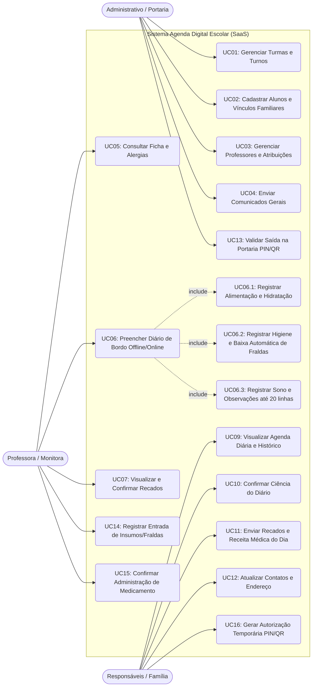
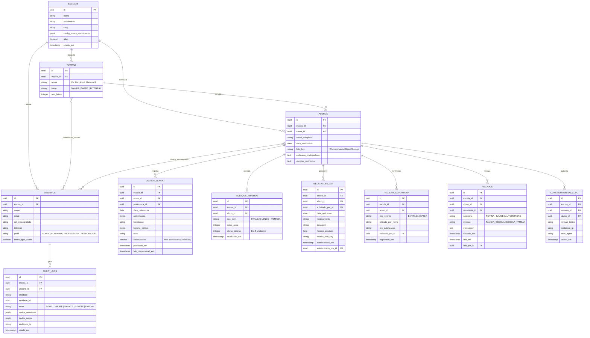
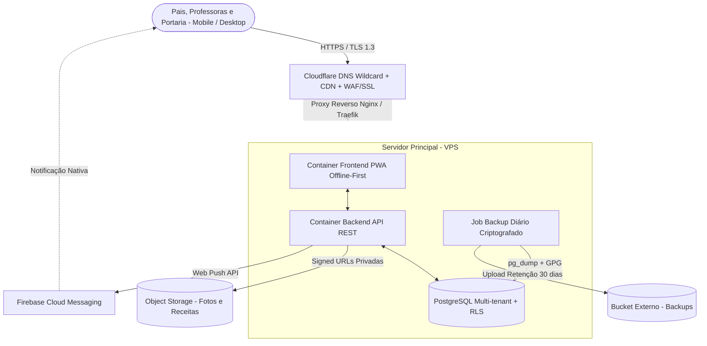

# Documentação de Projeto: Sistema de Agenda Digital Escolar Infantil

**Versão:** 1.2 (MVP + Infraestrutura + LGPD + Diferenciais Competitivos)

**Público-Alvo:** Escolas de Educação Infantil (Berçário, Maternal e Pré-escola)

**Plataforma:** Portal Web Responsivo Híbrido (Desktop + Mobile Android/iOS via PWA *Offline-First*)

**Modelo de Arquitetura:** SaaS Multi-tenant

---

## 1. Visão Geral e Posicionamento Estratégico

O sistema substitui a agenda física de papel utilizada na educação infantil por uma plataforma digital ágil, segura e pensada especificamente para a rotina de **berçário, maternal e pré-escola**. 

Diferente dos grandes sistemas generalistas do mercado (focados em ensino fundamental/médio, notas e cobranças complexas), este produto posiciona-se pela **ergonomia extrema em sala de aula ("One-Thumb UX")**, **operação resiliente a falhas de Wi-Fi (*Offline-First*)** e **recursos exclusivos para cuidados infantis** (controle automático de estoque de fraldas, gestão de medicamentos e portaria segura).

### 1.1. Escopo do Produto (Core + Diferenciais)

* **Gestão Multi-escola (Multi-tenant):** Isolamento lógico e matemático de dados por instituição de ensino (`escola_id`).
* **Prontuário da Criança:** Identificação completa, turma, turno, filiação (pai/mãe), endereço, contatos de emergência e alertas críticos de saúde/alergias.
* **Diário de Bordo Rápido (*One-Thumb* + Lote):** Registro individual ou em lote com botões de seleção rápida e campo de observações limitado a até 20 linhas (~1.800 caracteres).
* **Contador Inteligente de Insumos:** Baixa automática de fraldas/lenços a cada troca registrada e alerta preventivo aos pais quando o estoque da mochila atinge o nível mínimo.
* **Gestão de Medicamentos:** Receituário digital do dia com cronômetro visual para a professora e dupla confirmação de administração.
* **Portaria Segura (Check-in / Check-out):** Validação de retirada da criança por terceiros autorizados via PIN temporário ou QR Code, com notificação imediata aos pais.
* **Comunicação Bidirecional Estruturada:** Avisos organizados por categorias com confirmação explícita de leitura (*double-check*) e janela de atendimento configurável.
* **Acesso Híbrido (PWA *Offline-First*):** Instalável na tela inicial de smartphones Android e iOS, com fila de sincronização local (`IndexedDB`) caso a internet da sala oscile.

---

## 2. Análise de Mercado e Diferenciação Competitiva

### 2.1. Diagnóstico Estratégico (SWOT)

| Forças (Internas) | Fraquezas e Riscos Mitigados |
| :--- | :--- |
| • **Validação Orgânica:** Co-criação direta com professoras e coordenação em ambiente real. • **Infraestrutura Enxuta:** Custo fixo operacional baixo (~R$ 80–100/mês) garantindo margem líquida > 85%. • **Especialização no Nicho:** Interface limpa focada 100% nas dores do berçário e maternal. | • **Oscilação de Wi-Fi nas salas:** Mitigado com arquitetura *Offline-First* no PWA. • **Fricção de instalação no iOS:** Mitigado com tutorial guiado no primeiro login e fallback por e-mail/WhatsApp opcional. • **Baixa barreira de saída:** Mitigado com funcionalidades de alto valor agregado (estoque de fraldas, portaria e medicação). |

### 2.2. Comparativo com Players de Mercado

| Critério | Concorrentes Consolidados *(Agenda Edu, ClassApp, ClipEscola)* | Nossa Solução *(Diferencial Competitivo)* |
| :--- | :--- | :--- |
| **Precificação** | Ticket elevado (R$ 350 a R$ 1.200+/mês) + taxas de implantação. | Planos fixos previsíveis por faixa de alunos (R$ 149 a R$ 399/mês), sem taxa de adesão. |
| **Ergonomia na Sala** | Menus poluídos com módulos de ensino fundamental/médio. | Interface *One-Thumb* (uso com uma mão), lançamento em lote em < 15s e modo *Offline*. |
| **Comunicação** | Chat aberto que transforma a professora em atendente em tempo real. | Comunicação assíncrona por cards de motivo com *double-check* e janela de silenciamento. |
| **Controle de Insumos** | Inexistente (professora precisa lembrar de escrever no recado). | Desconto automático de fraldas no diário com disparo automático de reposição aos pais. |
| **Segurança na Saída** | Planilhas ou conferência verbal na portaria. | Check-out auditável com PIN/QR Code para autorizados e push instantâneo aos pais. |

---

## 3. Atores e Casos de Uso (UML)

### 3.1. Descrição dos Atores

1. **Administrativo / Coordenação / Portaria:** Configura a escola, turmas, turnos, alunos, vínculos familiares, professoras, comunicados institucionais e valida a saída de alunos na portaria.
2. **Professora / Monitora:** Consulta a ficha das crianças, registra o diário de bordo (online ou offline), gerencia o estoque de fraldas, administra medicamentos prescritos e lê/responde recados.
3. **Responsáveis (Pai / Mãe / Autorizados):** Acompanham o diário, confirmam ciência, enviam avisos e prescrições médicas do dia, geram PIN/QR Code para terceiros buscarem a criança e mantêm contatos atualizados.

### 3.2. Diagrama de Casos de Uso (Mermaid)

### 3.3. Detalhamento dos Casos de Uso Principais

| ID | Caso de Uso | Ator Principal | Descrição Resumida |
| :--- | :--- | :--- | :--- |
| **UC02** | Cadastrar Alunos e Vínculos | Administrativo | Registra dados da criança (nome, nascimento, foto, turma, turno, alergias), endereço e vincula os perfis de pai, mãe e pessoas autorizadas. |
| **UC06** | Preencher Diário de Bordo | Professora | Lançamento individual ou em lote para a turma com suporte a fila offline (`IndexedDB`), descontando automaticamente fraldas usadas. |
| **UC13/16** | Portaria Segura (PIN/QR) | Responsáveis / Portaria | Pai/mãe gera código temporário para pessoa autorizada; portaria valida o código e dispara alerta de saída em tempo real. |
| **UC14** | Controle de Insumos | Professora | Registra entrada de pacotes de fraldas/lenços; o sistema alerta os pais automaticamente quando o saldo atingir o mínimo configurado (ex.: 5 unidades). |
| **UC15** | Gestão de Medicamentos | Professora | Exibe prescrição enviada pelos pais com foto da receita e cronômetro visual; professora confirma horário e dose administrada. |

---

## 4. Especificação de Requisitos

### 4.1. Requisitos Funcionais (RF)

* **RF01 – Autenticação e Controle de Acesso (RBAC):** Autenticação via e-mail/CPF e senha com direcionamento por perfil (`ADMIN`, `PORTARIA`, `PROFESSORA`, `RESPONSAVEL`).
* **RF02 – Prontuário e Identificação:** Armazena nome completo, data de nascimento, foto privada, turma (Berçário, Maternal, Pré), turno (Manhã, Tarde, Integral), endereço completo, filiação e contatos de emergência.
* **RF03 – Alerta Crítico de Alergias:** Restrições alimentares ou medicamentosas permanecem fixadas em destaque vermelho no topo da ficha e na tela de diário.
* **RF04 – Registro de Rotina Estruturada:**
  * *Alimentação:* Lanche manhã, almoço, lanche tarde, mamadeira (`Comeu tudo`, `Metade`, `Pouco`, `Recusou`, `Não se aplica`).
  * *Hidratação:* Consumo de água/líquidos (`Excelente`, `Regular`, `Pouca`).
  * *Necessidades Fisiológicas / Higiene:* Quantidade de trocas de fraldas ou uso do banheiro, classificação (`Urina`, `Evacuação Normal`, `Pastosa`, `Líquida`) e registro de banho (`Sim`, `Não`).
  * *Sono:* Status do descanso (`Dormiu bem`, `Sono agitado`, `Não dormiu`).
* **RF05 – Campo de Observações:** Campo de texto livre limitado a **1.800 caracteres** (equivalente a 20 linhas padrão) com contador regressivo visível.
* **RF06 – Lançamento em Lote e Exceções:** Aplicação de status padrão para toda a turma com um toque, permitindo ajuste rápido apenas nas exceções individuais.
* **RF07 – Contador de Insumos da Mochila:** Saldo individual de fraldas/lenços por aluno com baixa automática a cada troca registrada no diário e notificação automática aos pais ao atingir o estoque mínimo.
* **RF08 – Prescrição e Controle de Medicação:** Cadastro diário pelos pais (medicamento, dosagem, horário, anexo da receita) com alerta na tela da professora e registro auditável de administração.
* **RF09 – Portaria Segura (Check-in / Check-out):** Registro de entrada e saída com validação via PIN/QR Code para terceiros autorizados e notificação push instantânea aos responsáveis legais.
* **RF10 – Mural de Recados Estruturado:** Mensagens categorizadas (*Rotina*, *Saúde*, *Autorização*) com confirmação de leitura (*Ciente*) e configuração de janela de atendimento pela escola.

### 4.2. Requisitos Não Funcionais (RNF)

* **RNF01 – Responsividade Híbrida (PWA):** Compatível com telas de 360px a 1920px, suportando `manifest.json` e *Service Workers* para instalação no Android e iOS.
* **RNF02 – Resiliência Offline (*Offline-First*):** O módulo da professora deve armazenar lançamentos localmente via `IndexedDB` na ausência de internet e sincronizar automaticamente em segundo plano assim que a conexão retornar.
* **RNF03 – Usabilidade *One-Thumb*:** Botões de ação posicionados na zona inferior de alcance do polegar, permitindo preencher um diário individual em menos de 15 segundos.
* **RNF04 – Isolamento Multi-tenant:** Todas as tabelas e consultas devem aplicar filtro obrigatório e políticas de segurança por `escola_id`.

---

## 5. Modelagem de Dados (Visão Conceitual / DER)

---

## 6. Stack Tecnológica Recomendada

* **Frontend (Web App / PWA):** Next.js (React) ou Nuxt (Vue) + Tailwind CSS + Shadcn/UI + **Dexie.js (IndexedDB)** para fila de sincronização *Offline-First*.
* **Backend (API REST):** Node.js (NestJS ou Fastify) ou C# (.NET 8) com autenticação JWT e validação de schemas (Zod/FluentValidation).
* **Banco de Dados:** PostgreSQL com **Row-Level Security (RLS)** para isolamento Multi-tenant garantido no nível do banco.
* **Armazenamento de Mídia:** Cloudflare R2 ou AWS S3 (buckets privados para fotos dos alunos e receitas médicas com *Signed URLs* temporárias).
* **Notificações Push:** Firebase Cloud Messaging (FCM) integrado ao Service Worker do PWA para Android e iOS (Safari iOS 16.4+).

---

## 7. Infraestrutura em Nuvem, Domínio e Viabilidade SaaS

### 7.1. Arquitetura de Hospedagem e Fluxo de Rede

1. **Domínio e Subdomínios Multi-tenant:** Registro de domínio principal (ex.: `agendakids.com.br`) com **DNS Wildcard** (`*.agendakids.com.br`), permitindo endereços exclusivos por escola (`escolinha1.agendakids.com.br`).
2. **Camada de Borda e Segurança (CDN + SSL):** Cloudflare fornecendo SSL/TLS automático, proteção DDoS e cache estático para carregamento rápido no 4G/5G.
3. **Servidor VPS Linux:** Instância Ubuntu/Debian com Docker Compose (4 vCPU, 8 GB RAM, 100 GB NVMe), suportando de **15 a 30 escolas simultâneas** (~2.000 a 4.000 alunos).
4. **Política de Backup (Regra 3-2-1):** `pg_dump` diário compactado e criptografado (GPG) enviado para bucket externo com retenção de 30 dias, somado a snapshots semanais da VPS.

### 7.2. Estimativa de Investimento e Modelo Comercial

| Componente | Provedor / Solução Sugerida | Custo Estimado | Periodicidade |
| :--- | :--- | :--- | :--- |
| **Registro de Domínio** | Registro.br (`.com.br`) | **R$ 40,00** | Anual (~R$ 3,33/mês) |
| **DNS, SSL e CDN** | Cloudflare (Plano Free) | **R$ 0,00** | Mensal |
| **Servidor VPS (Nuvem)** | Contabo / Hetzner / DigitalOcean (4 vCPU, 8 GB RAM) | **R$ 45,00 a R$ 80,00** | Mensal |
| **Storage + Backup Externo** | Cloudflare R2 (até 10 GB grátis) ou Backblaze B2 | **R$ 0,00 a R$ 15,00** | Mensal |
| **Notificações Push e E-mails** | Firebase Cloud Messaging + Resend/Brevo (Free Tier) | **R$ 0,00** | Mensal |
| **CUSTO OPERACIONAL TOTAL** | **Infraestrutura completa em produção** | **~R$ 50,00 a R$ 100,00** | **Por mês** |

#### Estratégia de Precificação e Go-to-Market
* **Planos por Faixa Fechada (Previsibilidade para a Escola):**
  * *Plano Berçário (até 50 alunos):* **R$ 149,00/mês**
  * *Plano Escola (até 120 alunos):* **R$ 249,00/mês**
  * *Plano Rede/Ilimitado:* **R$ 399,00/mês**
  * *Add-on Opcional:* Integração oficial/gateway WhatsApp (+R$ 59,00/mês).
* **Ponto de Equilíbrio (*Break-even*):** O primeiro cliente pagante cobre 100% do custo da infraestrutura, gerando margem líquida superior a 90% a partir do segundo contrato.
* **Estratégia Piloto:** Implantação gratuita de 60 dias na escola parceira inicial com migração assistida de planilhas em troca de validação de uso e depoimento comercial.

---

## 8. Conformidade LGPD e Segurança da Informação

Por tratar dados de **crianças menores de 12 anos** (Art. 14 da Lei nº 13.709/2018) e **dados pessoais sensíveis** (saúde, alimentação, necessidades fisiológicas e receituário médico — Art. 5º, II e Art. 11), o sistema aplica controles estritos:

### 8.1. Papéis Jurídicos e Contratos
* **Escola (Controladora):** Define a finalidade pedagógica da coleta e obtém o consentimento formal dos responsáveis na matrícula.
* **Plataforma SaaS (Operadora):** Processa e armazena os dados estritamente conforme instruções da escola, respaldada por um **DPA (*Data Processing Agreement*)** anexo ao contrato de assinatura.

### 8.2. Requisitos de Privacidade e Blindagem Técnica

| Camada | Implementação Obrigatória | Objetivo |
| :--- | :--- | :--- |
| **Consentimento (Art. 14)** | Aceite expresso no 1º login registrado em `CONSENTIMENTOS_LGPD` (IP, timestamp UTC, versão do termo, User-Agent) | Comprovação legal de autorização parental específica. |
| **Isolamento Multi-tenant** | Coluna `escola_id` + **Row-Level Security (RLS)** nativo no PostgreSQL | Impede vazamento entre escolas mesmo em caso de bug na API. |
| **Criptografia de Dados** | TLS 1.3 em trânsito + criptografia de coluna (`pgcrypto`/AES-256) para CPF, endereço e alergias | Protege dados sensíveis em repouso e nos backups. |
| **Mídia Privada (Fotos/Receitas)** | Buckets privados sem acesso público + **Signed URLs** com expiração de 15 minutos | Impede compartilhamento externo de links de fotos de crianças. |
| **Auditoria Imutável** | Tabela `AUDIT_LOGS` registrando leituras de prontuário, edições retroativas e validações de portaria | Rastreabilidade completa de ações internas e externas. |
| **Expurgo e Portabilidade** | Exportação do histórico da criança (JSON/PDF) e rotina de anonimização após encerramento do vínculo | Atendimento aos direitos do titular (Art. 18 da LGPD). |

---

## 9. Plano de Execução por Sprints (8 Semanas)

1. **Sprint 1 (Semanas 1-2) – Fundação, Multi-tenancy e Segurança Base:**
   * Provisionamento da VPS com Docker, DNS Wildcard/SSL, estrutura PostgreSQL com RLS, autenticação JWT e cadastro de escolas/turmas.
2. **Sprint 2 (Semanas 3-4) – Prontuário, Vínculos e Fluxo LGPD:**
   * CRUD de alunos (criptografia de dados sensíveis e upload privado de foto), cadastro de responsáveis, trilha de auditoria e aceite LGPD no primeiro acesso.
3. **Sprint 3 (Semanas 5-6) – Diário *Offline-First*, Insumos e Medicação:**
   * Tela *One-Thumb* da professora com fila `IndexedDB`, lançamento em lote, observações de 20 linhas, baixa automática de fraldas e cronômetro de medicação.
4. **Sprint 4 (Semanas 7-8) – Portaria Segura, Comunicação, PWA e Piloto:**
   * Validação de saída via PIN/QR Code, mural de recados com janela de atendimento, Web Push (FCM), backups criptografados e implantação piloto na escola.